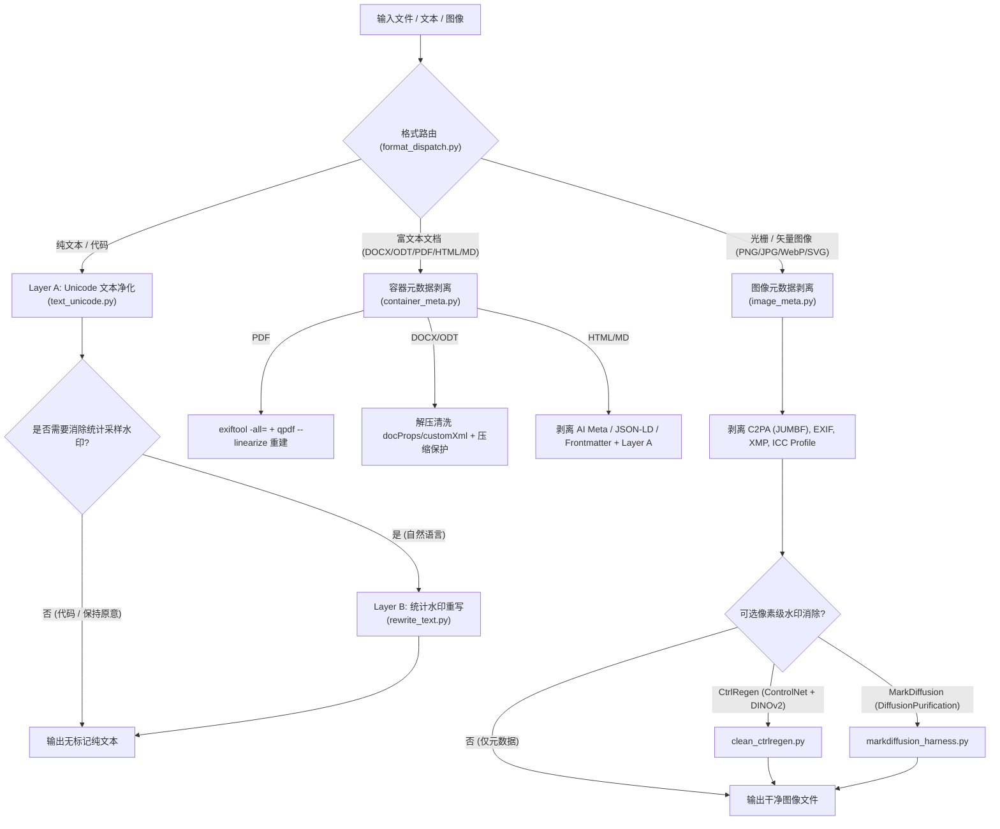

# watermarks-remover 深度技术研判与本地落地指南

> **项目地址**：[https://github.com/guillaumemeyer/watermarks-remover](https://github.com/guillaumemeyer/watermarks-remover)  
> **当前版本**：`v0.5.0` | **开源协议**：MIT License（核心服务）  
> **研判专家**：Tech Scout & Open-Source Adapt Pipe (Workflow D)  
> **研判日期**：2026-08-15

---

## 📌 一、 项目全景与核心价值定位

### 1.1 解决的核心痛点
在当前多模型时代（Claude、Gemini/SynthID、OpenAI、开源 LLM），AI 生成的内容（文本、图像、文档）往往会被嵌入各种形式的“数字版权/溯源标记（AI Provenance Marks）”：
1. **隐式 Unicode 字符注入**：如零宽空格（ZWSP）、双向文本控制符（Bidi）、变体选择符（VS）、标签字符（Tag Chars）等。
2. **统计采样水印（Statistical Token Watermarks）**：如 Kirchenbauer (KGW) 绿红列表采样、Google SynthID-Text，水印散布在词汇选择概率分布中。
3. **文件元数据与 C2PA 存证**：PNG/JPEG/WebP/PDF/DOCX/HTML 中嵌入的 Content Credentials (C2PA)、EXIF、XMP、docProps 等。
4. **像素域隐写水印**：如 SynthID Image、Tree-Ring、StegaStamp、StableSignature。

`watermarks-remover` 是一个**多厂商、跨生态、分层防御式的 AI 溯源标记清理与检测工具集**，采用**“Agent Skill（轻量客户端）+ Python 标准库 HTTP 微服务 + 可选重型模型后端”**的三层分离架构。

---

## 🏗️ 二、 系统架构与多层清理矩阵 (Cleaning Matrix)



### 2.1 清理层级与技术实现深度剖析

| 层次 (Layer) | 目标对象 | 覆盖厂商/标准 | 核心技术原理与算法 | 确定性 vs 概率性 |
| :--- | :--- | :--- | :--- | :--- |
| **Layer A** | 隐式 Unicode、零宽字符、同形异义空格 | Claude, Gemini, OpenAI, Web 抓取内容 | 正则与 Unicode 类别分类（`Cf`, `Co`），清洗 ZWSP (`U+200B`)、Bidi 覆盖、Tag 字符 (`U+E0001..7F`)、私有区 (PUA)；将同形异义空格规范化为 ASCII 空格；**智能保留 Emoji 粘合符 (`ZWJ`) 与复合小语种正字法** | **100% 确定性可验证** |
| **Layer B** | 统计生成水印 (Token-Sampling Bias) | Kirchenbauer (KGW), SynthID-Text | 调用非源头模型进行深度改写。支持 `paraphrase`（句法与虚词重构）、`humanize`（去 AI 味）、`code`（注释与局部变量混淆）、`backtranslate`（回译）；**多候选采样 + Bigram Jaccard 词汇发散度打分选优** | **概率性 (Best-effort)** |
| **容器元数据** | PDF, DOCX, ODT, HTML, MD | C2PA, Adobe XMP, Office docProps | **PDF**：先用 `exiftool -all=` 清理，再强制用 `qpdf --linearize` 进行对象图物理级重构（防增量恢复）；<br>**DOCX/ODT**：流式 Zip 预算防解压炸弹，剥离 `customXml` 与 `docProps` 中的 AI 生成器标识；<br>**HTML/MD**：正则剥离 AI generator、`DigitalSourceType` JSON-LD、Frontmatter AI 键值 | **100% 确定性** |
| **图像元数据** | PNG, JPEG, WebP, SVG | C2PA (JUMBF), EXIF, XMP, ICC | 纯标准库二进制解析 PNG Chunks (`caBX`, `juMB`, `iTXt`)、JPEG APP11/APP1 段、WebP RIFF `C2PA` 块、SVG `<metadata>`/RDF | **100% 确定性** |
| **像素域去除 (可选)** | 图像频域/隐空间水印 | SynthID Image, Tree-Ring, StableSignature | 外挂调用 **CtrlRegen**（ICLR 2025，SD 1.5 ControlNet + DINOv2 IP-Adapter + 512x512 自动分块余弦羽化融合）或 **MarkDiffusion** | **概率性重构** |

---

## 🔍 三、 源码亮点与工程设计闪光点

1. **绝对极简的依赖控制（Stdlib First）**：
   - 核心服务与所有基础 CLI 工具（`server.py`、`clean_text.py`、`clean_file.py`、`image_meta.py`、`container_meta.py`）**完全基于 Python 3.10+ 原生标准库编写**，不需要 `pip install` 任何第三方包即可完整跑通。
2. **防假删除与安全防御机制（Hardened Engineering）**：
   - **PDF 增量删除避坑**：深刻理解 `exiftool` 的增量修改机制（仅在尾部追加释放标记，原元数据仍残留在文件中），强制引入 `qpdf --linearize` 进行对象图物理级重建。
   - **Zip 炸弹防御**：DOCX/ODT 解析时动态累计 `info.file_size`，超过 128MB 预算立即熔断。
   - **原子写入与符号链接防御**：所有输出文件写入均采用 `临时文件 + 原子替换 (atomic rename)`，拒绝写入已存在的 symlink 目标。
   - **网络安全隔离**：Layer B 改写请求默认仅限本机回环（Loopback），禁止跨网段发送敏感文本，防止 API Key 在重定向中泄露。
3. **优雅的 Agent Skill 架构设计**：
   - Skill（`skills/remove-ai-marks/SKILL.md`）本身不包含任何执行代码，仅作为一个 HTTP 客户端向后台 `server.py` 发起 `/inspect` 与 `/clean` 请求，保证了 Agent 宿主环境的极致轻量与安全。

---

## 💻 四、 Windows 本地部署与上手实操指南

### 4.1 方案 A：极简原生运行（零依赖，秒级启动，推荐）

无需安装 Docker，直接使用当前系统的 Python：

```powershell
# 1. 切换到项目根目录
cd d:\antigravity\app\watermarks-remover

# 2. 启动核心 HTTP 服务 (端口 8765)
python service/scripts/server.py --host 127.0.0.1 --port 8765
```

服务就绪后，直接通过 PowerShell 或命令行即可调用：

```powershell
# 检查服务健康状态
curl http://127.0.0.1:8765/health

# 查看服务能力集 (支持哪些可选工具)
curl http://127.0.0.1:8765/capabilities

# 命令行直接清洗文件 (无须启服务)
python service/scripts/clean_file.py test.md -o test.cleaned.md
python service/scripts/clean_image.py input.png -o output.png
python service/scripts/clean_text.py input.txt -o output.txt --stats
```

### 4.2 方案 B：增强套件安装（启用 PDF 强力重构与 C2PA 深度检测）

若需要完美清洗 PDF 和深度检测 C2PA 元数据，可安装以下 Windows CLI 工具并加入系统 PATH：
- **`qpdf`**：`winget install qpdf` 或通过 Scoop/Chocolatey 安装（用于 PDF 物理级重构）。
- **`exiftool`**：`winget install OliverBetz.ExifTool`（用于深度元数据清洗）。
- **`c2patool`**：下载官方 Rust 编译版 release 即可。

### 4.3 方案 C：Docker 全功能矩阵启动

```powershell
# 启动基础清理服务
docker compose up -d

# 启动包含 MarkLLM / MarkDiffusion 水印验证套件
docker compose --profile harness up -d
```

---

## 💡 五、 对 Antigravity 智能体系统的转化启发与融合建议

1. **直接接入本系统的 Agent 技能库**：
   - 将 `skills/remove-ai-marks` 挂载或复制到 `C:\Users\Administrator\.gemini\antigravity\skills\remove-ai-marks`，并在后台保持 `server.py` 常驻，即可在全系统任意对话中通过 `/remove-ai-marks` 或自然语言一键清洗各类文字、图表、PPT 与 PDF 资产。
2. **与现有视觉水印清理技能形成互补**：
   - 现有技能 `gemini-watermark-remover` 专注于**右下角半透明图像水印 Badge 的逆 Alpha 混合物理消解**；
   - 本项目 `watermarks-remover` 专注于**底层隐式 Unicode、C2PA 元数据、文件容器结构及统计 Token 层面**的防溯源与文本净化。二者结合构成了完整的“视觉表面 + 底层协议 + 文本语义”全链路 AI 痕迹消除矩阵。
3. **沉淀防增量删除（PDF exiftool + qpdf）设计经验**：
   - 将该项目在 PDF 清洗中“exiftool 增量追加导致元数据依然残留，必须配合 qpdf 重建”的硬核工程经验，作为通用经验沉淀进 `pitfalls_media.md`。

---
*报告生成路径：[watermarks-remover_analysis.md](file:///d:/antigravity/app/watermarks-remover/watermarks-remover_analysis.md)*
